# TrackLoader / Top Gear port: complete logical node graph

Companion to [TECHNICAL_INFO.MD](TECHNICAL_INFO.MD), documented 9 November 2026.
Open this file in a Markdown preview with Mermaid support.

## Scope and legend

These graphs cover all major conversion components, the accepted media
post-processing chain, runtime eligibility/ownership, browser navigation,
and **all 61 node calls across the four generated custom stateflow states**.
Repeated state calls are separate nodes where execution requires them.

This is not a dump of every mesh vertex, all 288 zones, or all engine-internal
nodes recursively called by stock stateflow. Those are data/runtime dependencies,
not additional authored custom stateflow nodes. The complete generated custom
call inventory is represented in section 4.

- Solid arrows: data dependency or ordered execution.
- Dashed arrows: validation, cross-reference, optional path, or return to caller.
- Branch labels: explicit runtime or readiness decisions.
- Rejected experiments are segregated from the accepted path.
- `E`, `R`, `M`, and `W` prefixes identify entry, return, mainland resume, and
  locator wait calls. Their numeric order matches [build_visit.py](build_visit.py).

## 1. Source-to-package dependency graph

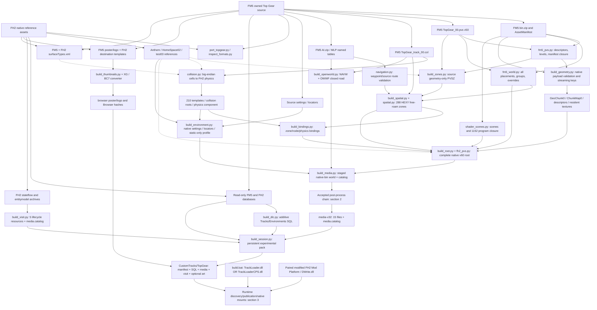

Audit/source serializers are not themselves a playable map. The geometry-only
zone component is an intermediate; final free-roam zones and the later global
closure supersede its selective source-view policy.

## 2. Accepted media chain and rejected branches

The sequence is grounded in persisted media reports, not a promise that every
operation already exists in one canonical build command.

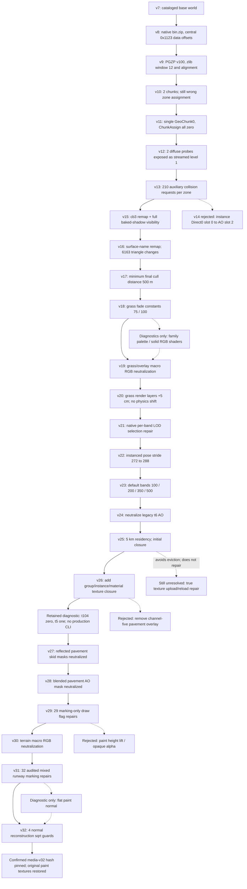

v14 is not a parent of v15. Diagnostic palette/height/alpha/flat-normal payloads
are not included in the accepted v32 result. The retained shadow diagnostic is
the explicit exception: it remains in the lineage with its limitations documented.

## 3. Runtime startup, ownership, and driver states

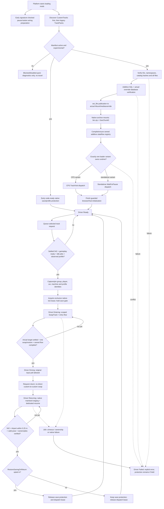

This is a dependency/state diagram, not a claim that the protection worker and
media validation run sequentially. Early protection deliberately runs in parallel.
The source driver also has **Unavailable** before initialization; Failed is not
silently reset to Ready after a native error.

## 4. Complete custom native stateflow

Source: [build_visit.py](build_visit.py), `flow("TopGearCPS")`.
The generated custom stategroup has four states:

| State | Node calls | Behaviors |
|---|---:|---|
| enter | 27 | GameControlWrapper, BlockPauseEntryWrapper, DisableMicroSaveWrapper |
| return_mainland | 14 | Same transition wrappers |
| resume_mainland | 18 | GameControlWrapper, BlockPauseEntryWrapper, DisableMicroSaveWrapper |
| wait_locators | 2 | Native condition and next-frame loop |
| Total | **61** | Wrapper behavior shown separately below |

Transition wrappers set GameControlWrapper force_take_control=false,
allow_failure=true, with onFailedToTakeControl handling. Native failure is not
drawn as a successful continuation. The player car is kept loaded across swaps.

### 4.1 Enter TopGearCPS: every node, in order

```mermaid
flowchart TB
    EROOT["trackloadercps.enter"]
    EWRAP["GameControlWrapper / BlockPauseEntryWrapper / DisableMicroSaveWrapper"]
    E01["track_swap.stop_car_and_fade_out"]
    E02["global.enable_mixer_snapshot"]
    E03["ui_screens.show_fmv_loading_screen_and_continue"]
    E04["global.apply_parking_brake_human"]
    E05["global.disable_car_control"]
    E06["track_swap.remove_all_ai_cars"]
    E07["track_swap.unload_navigation_world"]
    E08["track_swap.swap_track"]
    E09["track_swap.load_navigation_world"]
    E10["wait_locators"]
    E11["global.load_entity_group"]
    E12["global.ai_spawning_mode_none"]
    E13["global.restore_car_position"]
    E14["global.stop_car"]
    E15["global.apply_parking_brake_human"]
    E16["global.reset_camera_to_player"]
    E17["global.enable_track_streaming"]
    E18["global.wait_for_streaming_around_local_human_car"]
    E19["global.clear_mulligan_key_frames"]
    E20["global.disable_mixer_snapshot"]
    E21["global.fade_in"]
    E22["ui_screens.show_hud_and_continue"]
    E23["global.resume_all_huds"]
    E24["global.start_race"]
    E25["global.start_driving"]
    E26["global.enable_car_control"]
    E27["global.release_parking_brake_human"]
    EEND["Check owned native entry; then Driver Driving"]

    EROOT --> EWRAP --> E01 --> E02 --> E03 --> E04 --> E05 --> E06
    E06 --> E07 --> E08 --> E09 --> E10 --> E11 --> E12 --> E13 --> E14
    E14 --> E15 --> E16 --> E17 --> E18 --> E19 --> E20 --> E21
    E21 --> E22 --> E23 --> E24 --> E25 --> E26 --> E27 --> EEND
```

Call parameters not duplicated in the labels:

- E02/E20: snapshot BASE_Loading.
- E03: empty loading_reason.
- E08: wait=true; owned instruction scope sets track 10000 and recorded arrival.
- E09: track_name=TopGearCPS, ribbon=0.
- E11: entities_trackloadercps_static_route, wait_for_state_machine_exit=false,
  allow_replace_if_group_exists=true.
- E13: scoped position/facing restore.
- E19: start_recording_replay=false.
- E21: force=false.

### 4.2 Return from custom map: every node, in order

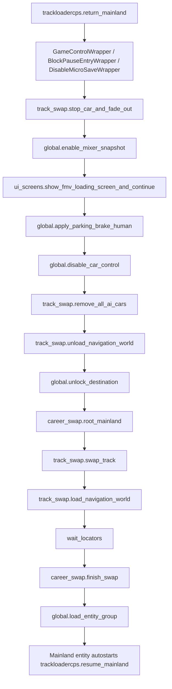

Parameters:

- R02: snapshot BASE_Loading.
- R03: empty loading_reason.
- R10: wait=true; scoped mainland/Airport target.
- R11: track_name=Anthem, ribbon=0.
- R14: entities_trackloadercps_mainland, wait_for_state_machine_exit=false,
  allow_replace_if_group_exists=true.
- The previously loaded static route contains a real Mainland TrackSwapComponent
  and WorldPosition 425.574,110.821,-1478.082.

### 4.3 Dedicated mainland resume: every node, in order

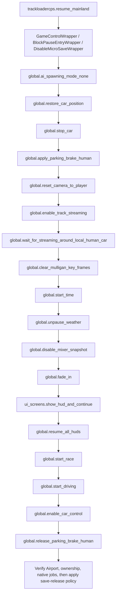

M02 restores the owned Airport pose. M08 uses start_recording_replay=false.
M11 uses BASE_Loading; M12 uses force=false. Airport heading need only be valid,
not match a fixed desired heading. Release is conditional, not an unconditional
consequence of reaching M18.

### 4.4 Shared locator wait: every node and branch

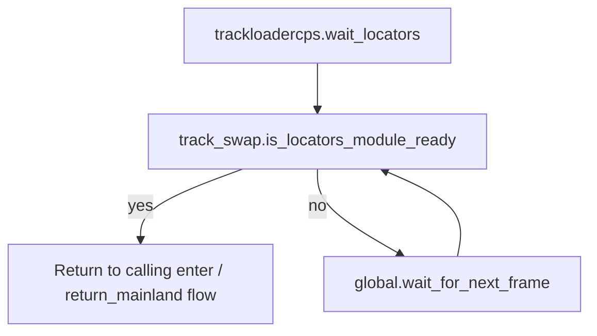

W01 has id `_is_locators_module_ready`; W02 has id `next_frame`.
Its exit targets are `.exit`, `next_frame`, and `_is_locators_module_ready`.
The higher-level driver deadline still applies; this loop is not forced ready.

## 5. Browser, native Back, and stock/custom routing

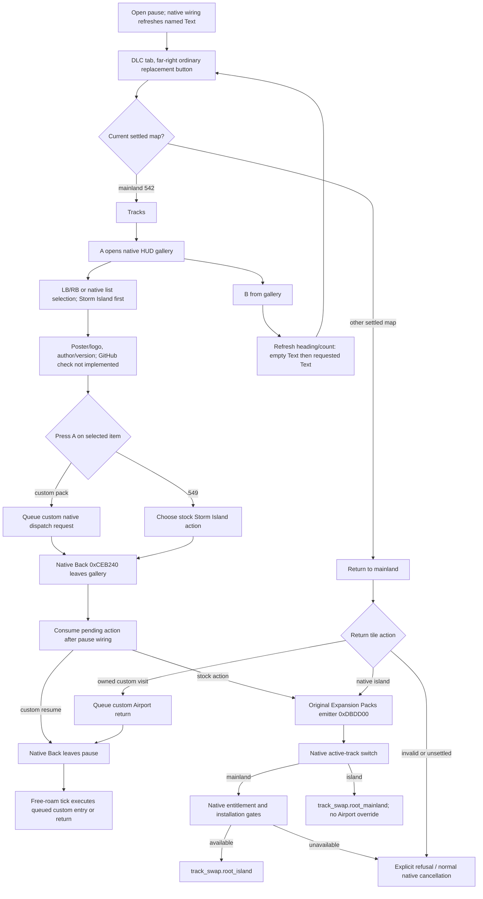

The gallery works without installed Storm Island. Displaying its row does not
bypass its native travel checks. Owner-only event dispatch and arbitrary HUD
exit names were rejected; native Back handles pages with a null owner too.

## 6. Texture conversion paths

### 6.1 World data: retained compressed payloads

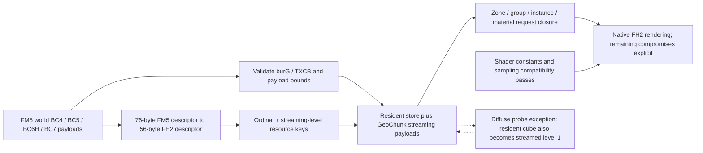

### 6.2 UI artwork: actual pixel decode and recompression

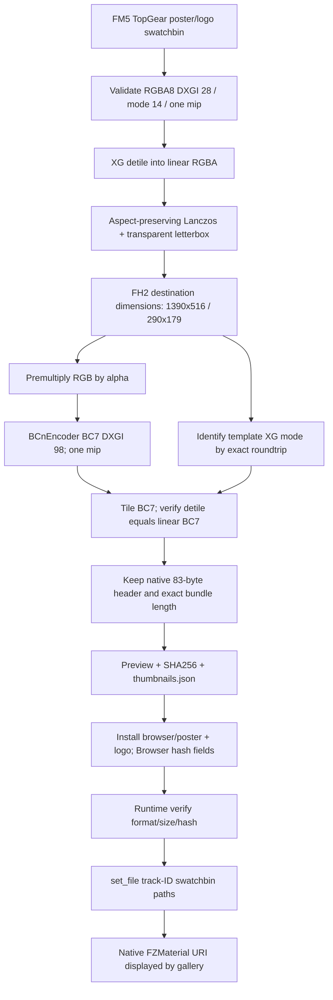

The byte-exact roundtrip is for tiling, not a claim that BC7 compression is
lossless. Native Storm Island placeholder images follow the runtime validation
path without FM5 image recompression.

## 7. Caption investigation: why the final path is different

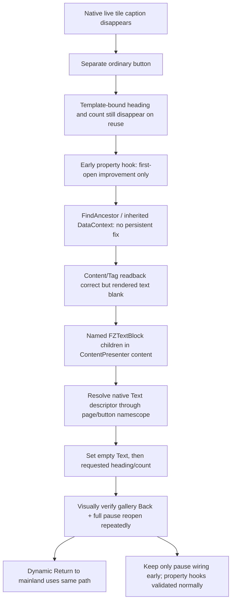

Native setter/readback success is not a substitute for C9. This distinction
prevented repeating the earlier false completion claims.

## 8. Validation gates

```mermaid
flowchart LR
    T0["Read-only source audit"]
    T1["Native schema roundtrips"]
    T2["Resource/hash/namespace closure"]
    T3["DXBC checksums + program validation"]
    T4["Offline loader/native host + platform API/XAML tests"]
    T5["Fresh correct-process launch"]
    T6["Actual rendering and moving-car/camera checks"]
    T7["Repeated gallery/pause and A-only travel checks"]
    T8["Verified Airport + job/owner/save-release checks"]
    T9["Repeat cycle without disarming Enabled"]
    T10["Retain known-good catalog and document limitations"]
    T0 --> T1 --> T2 --> T3 --> T4 --> T5 --> T6 --> T7 --> T8 --> T9 --> T10
```

Each gate establishes only its own layer. None eliminates the need for offline
save backups or turns this experimental port into a general career-safe release.

Documentation checks: all 12 Mermaid graphs parsed and rendered with Mermaid 11.
All 61 numbered native call nodes match the generator in order; the four states,
including wrappers, parameters, and exits, also match the preserved visit-v9 XML
after ignoring formatting whitespace. Relative document links and heading
anchors were checked against this workspace.
